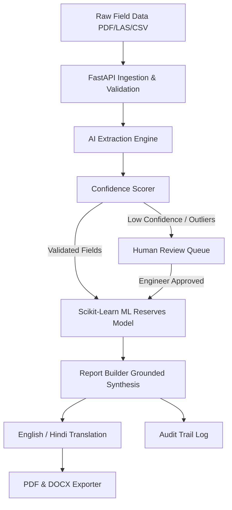

# CoalIQ — AI-Powered Geological, Mining & Reporting Solution
**Smart India Hackathon 2026 (Problem Statement SIH26023)**  
*Designed for CMPDI and Coal India Limited (CIL) Subsidiaries*

CoalIQ turns raw, unstandardized field data (borehole logs, LAS files, survey sheets, scanned PDFs) into validated, standard-format CMPDI geological reports, enforcing human-in-the-loop engineer approval for every output.

---

## Key Features

1. **Dashboard**: Live GIS Leaflet map of ~25 boreholes in Talcher Coalfield, Odisha with clickable marker popups, KPI cards, and Recharts effort reduction comparison (Manual 10 days -> CoalIQ 2 days).
2. **Data Ingestion**: Multi-format drag-and-drop dragzone (PDF, CSV, LAS) with real-time processing pipeline and automated geological range & unit checks.
3. **AI Extraction View**: Side-by-side view with source document scan on the left and structured extracted fields on the right. Per-field confidence scores highlight low-confidence (<80%) or anomalous fields in red.
4. **Seam & Grade Insights**: Vertical lithology strip logs, multi-borehole seam correlation profiles, and Scikit-Learn spatial ML reserve & grade estimations with explainable citations `[BH-01, 145.0-158.2 m]`.
5. **Human Review Queue**: Engineers review, approve, edit, or reject flagged fields. Edits are recorded to log feedback loops ("Learning from engineer edits").
6. **Report Builder**: Generates CMPDI Geological Reports auto-filled from extracted data, grounded narrative synthesis with inline citations, and English <-> Hindi language toggle.
7. **Export & Governance**: One-click download as PDF and DOCX, plus complete cryptographic audit log tracking user actions.
8. **Auth Context**: Lightweight role switcher (Engineer, Mining Planner, Management).

---

## Quick Start Guide

### Prerequisites
- Python 3.10+
- Node.js 18+ and npm

### 1. Install Dependencies

#### Backend
```bash
python -m pip install -r backend/requirements.txt
```

#### Frontend
```bash
cd frontend
npm install
cd ..
```

---

### 2. Run Application Locally

#### Terminal 1: Start Backend API (FastAPI)
```bash
$env:PYTHONPATH="backend"
python -m uvicorn app.main:app --reload --port 8000
```
*(Backend API will run at `http://127.0.0.1:8000` with Swagger docs at `http://127.0.0.1:8000/docs`)*

#### Terminal 2: Start Frontend (Vite React)
```bash
cd frontend
npm run dev
```
*(Frontend UI will open at `http://localhost:5173`)*

---

## Running Unit Tests

Run backend automated tests for validation rules and report exports:
```bash
$env:PYTHONPATH="backend"
python -m pytest backend/tests
```

---

## System Architecture



---

## Prototype vs Production Summary

| Component | Prototype (CoalIQ Demo) | Production Target |
| :--- | :--- | :--- |
| **Database** | SQLite with SQLAlchemy ORM | PostgreSQL + PostGIS |
| **ML Engine** | Scikit-Learn Spatial IDW Regressor | 3D GemPy / PyVista Geological Kriging |
| **OCR Engine** | pytesseract & pdfplumber with fallback | Custom Vision-LLM fine-tuned on CMPDI archives |
| **Report Export** | `python-docx` + `reportlab` | Production PDF pipeline with digital signature verification |
