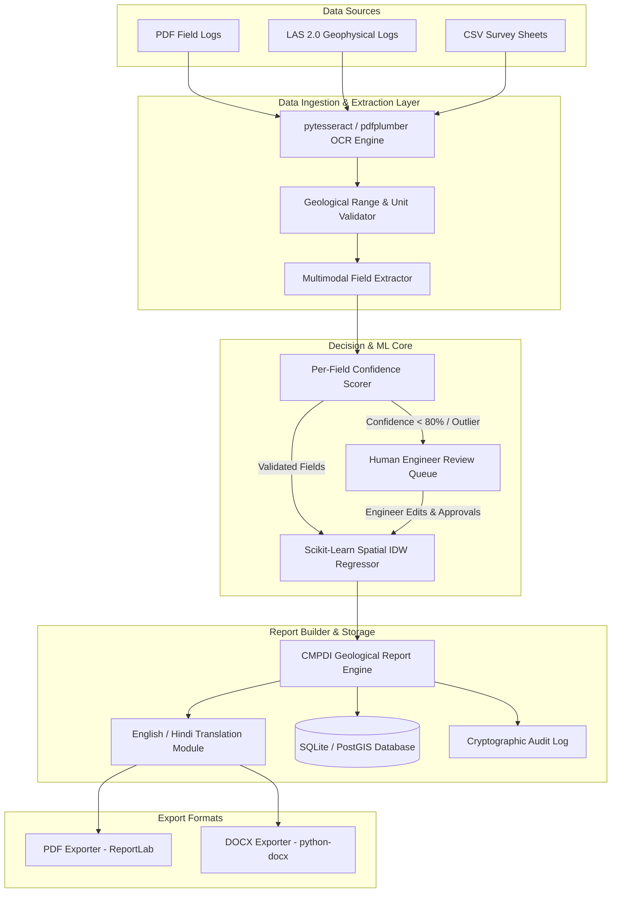

# CoalIQ System Architecture & Data Flow

CoalIQ (PS SIH26023) is an AI-powered geological, mining, and reporting solution designed for CMPDI and Coal India Limited (CIL) subsidiaries.

## Architecture Diagram (Mermaid)

## System Components

1. **Backend Framework**: Python FastAPI (`/api/boreholes`, `/api/ingestion`, `/api/extraction`, `/api/insights`, `/api/review`, `/api/reports`, `/api/audit`).
2. **Database Engine**: SQLite with SQLAlchemy ORM (Schema configured to be 100% PostgreSQL/PostGIS compatible for production).
3. **ML & Analytics**: `scikit-learn` spatial K-Nearest Neighbors regressor for coal reserve volume calculation and grade (G1-G17) classification.
4. **Report Engine**: Grounded CMPDI template generator with inline citations (`[BH-XX, depth m]`), supporting English and Hindi translations, exporting directly to `.pdf` and `.docx`.
5. **Frontend Application**: React 18 (Vite) + Tailwind CSS + Leaflet GIS map + Recharts.
